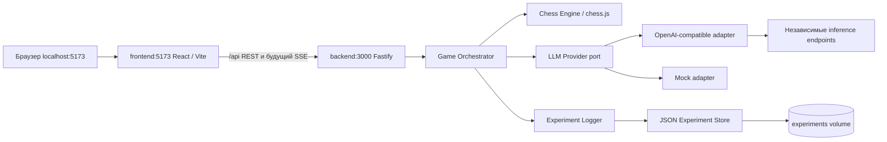

# Архитектура LLM Chess Arena

## Решение первого этапа

Модульный backend и отдельный frontend, два сервиса Compose в общей сети по умолчанию. Игра и вызовы моделей остаются в одном backend-процессе. Это упрощает управление конкурентными командами и локальное развёртывание. Никакие GPU, API-ключи или inference endpoints не нужны для старта.

На этапе 1 работают Vite, Fastify, health route, проверка готовности каталога данных, тесты и Docker-окружение. Остальные блоки на диаграмме — целевая архитектура, их реализация отложена. `backend/src/llm/provider.ts` содержит только контракт провайдера.

## Компоненты и границы

| Компонент | Ответственность и основной интерфейс | Планируемое расположение |
| --- | --- | --- |
| HTTP API | Валидация команд, HTTP-коды, сериализация публичных DTO; без игровой логики. Сейчас `GET /api/health`. | `backend/src/routes/` |
| Chess Engine | `snapshot()`, `legalMovesUci()`, `applyMove(uci)`, `exportPgn()`. Владеет chess.js; отдаёт FEN, ASCII, историю, turn, game outcome. Некорректный ход не изменяет состояние. | `backend/src/domain/chess/` |
| LLM Provider | `probe(config, signal)` и `complete(config, request, signal)`. Возвращает сырой текст, время и доступные токены/метаданные; не применяет ходы. | `backend/src/llm/provider.ts`, затем `llm/adapters/` |
| Prompt Builder | Симметричный контекст для двух цветов, редактируемый system prompt, режим A/B, FEN/ASCII/история, легальные UCI только в B. | `backend/src/application/prompts/` |
| Response Parser | Выделяет и проверяет `{ "move": "e2e4" }`, классифицирует InvalidFormat/EmptyResponse. Не исправляет ответы. | `backend/src/application/` |
| Game Orchestrator | `start/pause/resume/nextMove/stop/reset/getSnapshot`; выбор игрока, retries, тайм-ауты, один ход за раз, лимит полуходов и состояния матча. Зависит от портов, а не SDK провайдера. | `backend/src/application/` |
| Experiment Logger | Записывает запросы, ответы, все попытки, ошибки, время, токены, события и итог. Отдельная агрегация статистики. | `backend/src/experiments/` |
| Experiment Store | `save(record)`, `get(id)`, `list()`, экспорт JSON; атомарная запись в DATA_DIR. Файлы содержат schemaVersion. | `backend/src/storage/` |
| Event Publisher | SSE `snapshot/attempt/move/error/status/completed` с experimentId, revision и последовательным eventId; heartbeat и закрытие соединений. | `backend/src/events/` |
| Frontend | API client, представление состояния, доска, панели настроек/журнала/статистики. Навигация по истории локальна и не изменяет игру. | `frontend/src/` |

Названия будущих методов — проектное предложение, не уже существующий публичный API. Интерфейсы уточняются на соответствующих этапах вместе с тестами. Пока нет основания выделять shared package; публичные схемы появятся вместе с API матчей, чтобы контракт не расходился между сервисами.

## Модели и локальный inference

У каждого игрока собственный `ModelConfiguration`: provider, baseUrl, modelId, runtime, revision, quantization, maxContextTokens, timeoutMs и параметры генерации. API-ключ разрешается из имени server env-переменной внутри адаптера. Конфигурация для журнала/браузера не содержит ключей; имя переменной также не является частью публичного DTO.

`probe` проверяет модель и возможности endpoint до начала эксперимента. Параметры, которые runtime не поддерживает, отклоняются или явно исключаются с диагностикой; нельзя молча искажать записанную конфигурацию. HTTP/provider ошибки, timeout, пустой ответ и неверный формат различаются. AbortSignal распространяется до fetch; ошибка GPU/OOM не завершает backend. Если runtime не сообщает время загрузки/генерации, поля остаются отсутствующими, а не заполняются предположениями.

OpenAI, OpenRouter, vLLM CUDA, vLLM-Metal, Ollama и Docker Model Runner подключаются через OpenAI-compatible HTTP adapter. Две модели могут использовать разные endpoints; один vLLM instance не предполагается универсальным multi-model сервером. Mock Provider появится до реальной интеграции.

На этапе LLM-интеграции добавится необязательный Compose profile `nvidia`: официальный образ vLLM с проверенной совместимостью CUDA/Blackwell sm_120, GPU reservation, cache volume, ограничениями контекста и памяти. На macOS backend обращается к inference на хосте через `host.docker.internal`; Metal не передаётся в Linux-контейнер. В основном Compose уже есть host-gateway для Linux.

## Состояние и конкурентность (следующие этапы)

Состояния матча: idle → running ↔ paused → completed/stopped/failed. Игровой результат отделён от состояния исполнения. Лимит ошибок даёт техническое поражение; Stop не придумывает шахматного победителя.

Одна последовательная операция хода на партию. Pause запрещает следующий запрос, но допускает завершение текущего. Next Move выполняет один цикл хода (включая разрешённые retries) и возвращает paused. Stop/Reset отменяют активный запрос и увеличивают generation/revision; ответ проверяет актуальность перед изменением доски и перед публикацией. До применения легального хода сохраняются исходная позиция и попытка, после применения — новое состояние и событие. Ошибочные попытки сохраняются, доска остаётся прежней.

Файлы экспериментов сохраняются после каждой значимой операции и при завершении. Временный файл + rename в пределах volume защищают отдельную запись от частичной перезаписи. SSE начинает с актуального snapshot; переподключение не должно терять состояние. На SIGTERM оркестратор прекращает новые запросы, отменяет активные, сохраняет журнал и закрывает SSE в пределах grace period.

## Docker и текущий HTTP-контракт

- Node.js 24 LTS, Debian slim, TypeScript strict, ESM. Отдельные package-lock.json, установка `npm ci` в build stage. Приложения работают от пользователя node, Compose init пересылает сигналы и собирает дочерние процессы.
- Bind mounts исходников; отдельные анонимные volumes для node_modules/dist. Dependencies устанавливаются при сборке; обновление lockfile требует пересборки и `--renew-anon-volumes`.
- Vite слушает 0.0.0.0:5173, Fastify — 0.0.0.0:3000. На хост порты публикуются только через 127.0.0.1. Браузер не использует Docker DNS и не получает переменные backend.
- Vite проксирует `/api` целиком на `http://backend:3000`, без тайм-аутов прокси для будущих SSE. Реальная SSE-передача будет проверена на этапе событий.
- Polling включён по умолчанию у Vite и nodemon через Chokidar env; интервал 500 мс. nodemon перезапускает backend с SIGTERM. `exec node` в nodemon.json заменяет промежуточную POSIX-оболочку, чтобы сигналы остановки доходили до Fastify и watcher дожидался закрытия приложения. Vite использует HMR.
- Backend проверяет доступность DATA_DIR перед listen. Compose запускает frontend после backend health check. Оба сервиса имеют HTTP health checks, stop_grace_period 15 секунд; backend ждёт close до 10 секунд.
- `GET /api/health` → HTTP 200, `Cache-Control: no-store`, `{"status":"ok","service":"backend"}`. Нет конфигурации, ключей, provider URLs и файловых путей. Недоступное хранилище не позволяет backend запуститься.
- Страница проверяет настоящий health endpoint при открытии и по кнопке, имеет timeout 5 секунд и состояния ожидания/успеха/ошибки. Никаких шахматных или LLM-заглушек.

## Изученные API

При реализации проверены актуальные API и совместимость: [Vite server/proxy/watch](https://vite.dev/config/server-options), [Fastify listen](https://fastify.dev/docs/latest/Guides/Getting-Started/), [Fastify inject](https://fastify.dev/docs/latest/Guides/Testing/), [Vitest](https://vitest.dev/guide/), [Compose startup order](https://docs.docker.com/compose/how-tos/startup-order/), [nodemon polling/signals](https://github.com/remy/nodemon), [Playwright Docker](https://playwright.dev/docs/docker). Версии библиотек разрешены через npm registry внутри Docker и зафиксированы lock-файлами. Использованы React 19.3.1, Vite 8.3.8, Fastify 5.12.8, TypeScript 6.0.3 и Vitest 5.1.0. TypeScript 6.0 выбран из-за peer dependency typescript-eslint 8.72.2 (`>=4.8.4 <6.1.0`): TypeScript 7 пока несовместим с выбранным линтером. API chess.js/react-chessboard и inference runtimes будут проверены перед их фактическим подключением.
