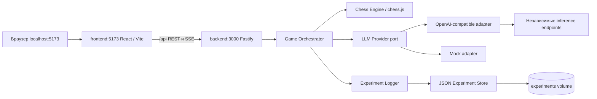

# Архитектура LLM Chess Arena

## Решение первого этапа

Модульный backend и отдельный frontend, два сервиса Compose в общей сети по умолчанию. Игра и вызовы моделей остаются в одном backend-процессе. Это упрощает управление конкурентными командами и локальное развёртывание. Никакие GPU, API-ключи или inference endpoints не нужны для старта.

На этапе 1 созданы Vite, Fastify, health route, проверка готовности каталога данных и Docker-окружение. На этапе 2 добавлены Chess Engine, оркестратор, Mock Provider, REST, Prompt Builder/Parser и EventJournal с подписками. На этапе 3 реализованы веб-интерфейс и SSE. На этапе 4A подключён внешний Chat Completions adapter; постоянные Logger/Store — этап 4B.

Контракты DTO и JSON-схемы находятся в `backend/src/contracts/match.ts`; домен импортирует только их TypeScript-типы, не HTTP-фреймворк. `routes/matches.ts` адаптирует REST к `MatchService`, который создаёт оркестраторы и связывает игроков с Mock либо Chat Completions adapter через factory. Внутри Mock нет собственной шахматной логики: список ходов внедряет композиция через Chess Engine. Подробности API и полей: [api.md](api.md).

## Компоненты и границы

| Компонент | Ответственность и основной интерфейс | Планируемое расположение |
| --- | --- | --- |
| HTTP API | Валидация команд, HTTP-коды, сериализация публичных DTO; без игровой логики. Health и REST матчей реализованы. | `backend/src/routes/` |
| Chess Engine | `snapshot()`, `legalMovesUci()`, `applyMove(uci)`, `exportPgn()`. Владеет chess.js; отдаёт FEN, ASCII, историю, turn, game outcome. Некорректный ход не изменяет состояние. | `backend/src/domain/chess/` |
| LLM Provider | `probe(config, signal)` и `complete(config, request, signal)`. Возвращает сырой текст, время и доступные токены/метаданные; не применяет ходы. | `backend/src/llm/provider.ts`, `llm/openai-compatible.ts`, `llm/mock-provider.ts` |
| Prompt Builder | Симметричный контекст для двух цветов, редактируемый system prompt, режим A/B, FEN/ASCII/история, легальные UCI только в B. | `backend/src/application/prompts/` |
| Response Parser | Выделяет и проверяет `{ "move": "e2e4" }`, классифицирует InvalidFormat/EmptyResponse. Не исправляет ответы. | `backend/src/application/` |
| Game Orchestrator | `start/pause/resume/nextMove/stop/reset/getSnapshot`; выбор игрока, retries, тайм-ауты, один ход за раз, лимит полуходов и состояния матча. Зависит от портов, а не SDK провайдера. | `backend/src/application/` |
| Experiment Logger | Записывает запросы, ответы, все попытки, ошибки, время, токены, события и итог. Отдельная агрегация статистики. | `backend/src/experiments/` |
| Experiment Store | `save(record)`, `get(id)`, `list()`, экспорт JSON; атомарная запись в DATA_DIR. Файлы содержат schemaVersion. | `backend/src/storage/` |
| Event Publisher | SSE `snapshot/match` с versioned DTO, matchId/gameId, sequence и полным снимком; heartbeat и закрытие соединений. Реализован. | `backend/src/routes/matches.ts` |
| Frontend | API client, представление состояния, доска, панели настроек/журнала/статистики. Навигация по истории локальна и не изменяет игру. | `frontend/src/` |

В таблице сохраняются целевые границы; JSON Store ещё не реализован. Текущий REST/SSE-контракт зафиксирован в TypeBox/Static и документации API. Публичные типы frontend находятся в api/contracts.ts; канонические схемы остаются в backend/src/contracts/match.ts. Общего runtime-пакета и chess.js на frontend нет.

## Модели и локальный inference

У каждого игрока собственный `ModelConfiguration`: provider, baseUrl, modelId, timeoutMs и параметры генерации. Контракт сохраняет поля будущих runtime-метаданных. Публичные настройки — union MockSettings/CompatibleSettings; старый Mock DTO без provider остаётся совместимым. Общий systemPrompt — fallback, отдельный players[color].systemPrompt имеет приоритет. Шаблоны проверяются при создании, color/fen/ascii/history подставляются перед каждой попыткой.

ProviderCredentials загружает ключи из server env при композиции зависимостей. LLM_ENDPOINTS_JSON связывает публичный alias с Base URL и именем env-переменной; браузеру доступны только alias/URL. Ключ разрешается исключительно для точного нормализованного Base URL. URL userinfo/query/fragment и HTTP redirects запрещены. HTTP-ошибки используют безопасные сообщения без тела upstream; известные ключи редактируются даже при отражении в message.content. Конфигурации/промпты/события не получают значения секретов или имена env ключей.

`probe` проверяет модель и выбранные параметры тестовым completion до первого хода обоих игроков и по кнопке UI. Универсального capabilities API нет: успех подтверждает принятие полей endpoint, а не доказывает их применение. Это указано в диагностике. Параметры никогда не удаляются и не заменяются автоматически; 400/422 возвращает ошибку конфигурации. Температура/лимит могут отсутствовать, имя лимита и JSON mode задаются явно. Preflight расходует токены; его результаты/usage отдельно хранятся в snapshot.providerChecks. Нажатие Apply не вызывает внешний API.

Native fetch выполняет один non-streaming POST /chat/completions. Тайм-аут/AbortSignal охватывают заголовки и чтение тела, предел ответа 1 MiB проверяется по Content-Length и накопленным bytes. 429 и сетевые ошибки используют обычный бюджет попыток без внутренних HTTP retries. Из ответа берутся только message.content, finish_reason и стандартный usage; скрытые reasoning-поля не сохраняются. Attempt.metrics и ProviderCheck.metrics имеют null для неизвестных токенов/времени генерации/загрузки. elapsedMs — полный интервал попытки, responseTimeMs — HTTP-ответ; они не выдаются за время генерации. Ошибка одного endpoint не завершает backend.

Совместимые облачные и локальные API подключаются через общий HTTP adapter. Две модели могут использовать разные endpoints, один и тот же endpoint или играть против Mock. Конкретные runtimes и настоящие модели пока не проверены; специализированная инфраструктура vLLM CUDA отложена до этапа 5.

На этапе 5 добавится необязательный Compose profile `nvidia`: официальный образ vLLM с проверенной совместимостью CUDA/Blackwell sm_120, GPU reservation, cache volume, ограничениями контекста и памяти. На macOS backend обращается к inference на хосте через `host.docker.internal`; Metal не передаётся в Linux-контейнер. В основном Compose уже есть host-gateway для Linux.

## Состояние и конкурентность (реализовано на этапе 2)

Состояния матча: Created → Running ↔ Paused → Completed/Stopped. Первый NextMove допускается из Created и оставляет Paused. Игровой результат отделён от состояния исполнения: Chess/ClaimedDraw/TechnicalLoss/Limit/Stopped. Лимит ошибок даёт техническое поражение; Stop и лимит полуходов не придумывают шахматного победителя. Три повторения/50 ходов только дают право заявления, автоматические ничьи — пять повторений/75 ходов. Проверка легальности, мата, пата и материала делегирована chess.js.

Одна последовательная операция на партию, включая preflight. Pause запрещает следующий запрос, но допускает завершение текущего; неиспользованный бюджет retries и feedback остаются до Resume/NextMove. NextMove выполняет один цикл хода с retries и остаётся Paused. Конкурирующие NextMove/Resume при busy=true отклоняются. Start/Resume в Running не создают второй цикл. Между автоматическими ходами оркестратор уступает event loop, чтобы HTTP Pause/Stop не блокировались быстрыми Mock-ответами.

Stop/Reset отменяют запрос. Reset сохраняет UUID ресурса, увеличивает generation и создаёт новый gameId/engine/providers. Каждый ответ проверяет идентичность текущей сессии/операции перед изменением доски и публикацией. Promise гонки timeout/cancellation завершается даже для адаптера, игнорирующего AbortSignal; запоздавшие ответы игнорируются. Попытка записывается до запроса и завершается как Accepted/Rejected/Cancelled; ошибочная попытка не меняет позицию. EventJournal выдаёт монотонные sequence и копии, журнал событий сохраняется между Reset в RAM.

На SIGTERM Fastify preClose отменяет операции до ожидания активных HTTP-обработчиков, поэтому длительный NextMove не блокирует shutdown. Матч получает Stopped/ServerShutdown; сохранения на диск пока нет.

## Интерфейс и SSE (этап 3)

React получает backend snapshot через REST/SSE; react-chessboard 5.12.1 использует `options.position`, `squareStyles`, `boardOrientation`, `allowDragging:false`. Независимого шахматного движка в браузере нет. История выбирает FEN из position.positions, подсветка берётся из UCI/SAN backend. Панели игроков и статистика — проекции history/attempts. Конфигурация независимых игроков и системная инструкция отделены от доски, что позволяет расширить формы настоящими моделями без изменения компоновки.

`/api/matches/:id/stream` отправляет начальный snapshot, затем versioned `{event,snapshot}` с SSE id=sequence и heartbeat 15 с. Финальное служебное OperationSettled сообщает busy=false. При disconnect снимаются подписки/таймеры; backpressure отключает медленного клиента, preClose закрывает потоки до ожидания HTTP handlers. Отдельный StreamUpdateSchema находится рядом с остальными TypeBox-контрактами.

EventSource автоматически переподключается. После каждого подключения клиент читает REST snapshot и страницы журнала после последнего подтверждённого REST-курсора. Поток продолжает приниматься параллельно: журнал дедуплицируется по sequence, снимки принимаются по generation/lastEventSequence, события фильтруются по gameId. Reset очищает показанный журнал и выбор истории. NextMove не повторяется автоматически после сетевой ошибки; REST уточняет состояние. Постоянного polling нет. UUID матча хранится в sessionStorage для восстановления вкладки.

Текущие матчи, события и попытки — в RAM и теряются при перезапуске backend. При 404 интерфейс предлагает переподключиться; новый матч создаётся только явным действием пользователя. Этап 4B добавит атомарный JSON Store (временный файл + rename в DATA_DIR), архив, экспорт и сохранение при shutdown. Существующий volume experiments сохраняется при пересоздании сервисов, но RAM-матчи туда ещё не пишутся.

На этапе 4A изучена официальная документация [OpenAI Chat Completions](https://developers.openai.com/api/reference/resources/chat/subresources/completions/methods/create), [совместимости Ollama](https://docs.ollama.com/api/openai-compatibility) и [OpenRouter Chat Completions](https://openrouter.ai/docs/api/api-reference/chat/create-a-chat-completion). Она определяет messages/content/usage, различия max_tokens/max_completion_tokens и опциональность JSON mode. Реальные endpoints этих поставщиков в автоматических тестах не вызываются.

## Docker и текущий HTTP-контракт

- Node.js 24 LTS, Debian slim, TypeScript strict, ESM. Отдельные package-lock.json, установка `npm ci` в build stage. Приложения работают от пользователя node, Compose init пересылает сигналы и собирает дочерние процессы.
- Bind mounts исходников; отдельные анонимные volumes для node_modules/dist. Dependencies устанавливаются при сборке; обновление lockfile требует пересборки и `--renew-anon-volumes`.
- Vite слушает 0.0.0.0:5173, Fastify — 0.0.0.0:3000. На хост порты публикуются только через 127.0.0.1. Браузер не использует Docker DNS и не получает переменные backend.
- Vite проксирует `/api` целиком на `http://backend:3000`, без тайм-аутов прокси для SSE. Поток проверяется браузерными тестами через этот proxy.
- Polling включён по умолчанию у Vite и nodemon через Chokidar env; интервал 500 мс. nodemon перезапускает backend с SIGTERM. `exec node` в nodemon.json заменяет промежуточную POSIX-оболочку, чтобы сигналы остановки доходили до Fastify и watcher дожидался закрытия приложения. Vite использует HMR.
- Backend проверяет доступность DATA_DIR перед listen. Compose запускает frontend после backend health check. Оба сервиса имеют HTTP health checks, stop_grace_period 15 секунд; backend ждёт close до 10 секунд.
- `GET /api/health` → HTTP 200, `Cache-Control: no-store`, `{"status":"ok","service":"backend"}`. Нет конфигурации, ключей, provider URLs и файловых путей. Недоступное хранилище не позволяет backend запуститься.
- Страница создаёт/восстанавливает Mock-матч через REST и подключает SSE; отдельный health endpoint используется Docker health checks. В интерфейсе есть состояния инициализации, ответа модели, паузы, ошибки и завершения.

## Изученные API

При реализации проверены актуальные API и совместимость: [Vite server/proxy/watch](https://vite.dev/config/server-options), [Fastify listen](https://fastify.dev/docs/latest/Guides/Getting-Started/), [Fastify inject](https://fastify.dev/docs/latest/Guides/Testing/), [Vitest](https://vitest.dev/guide/), [Compose startup order](https://docs.docker.com/compose/how-tos/startup-order/), [nodemon polling/signals](https://github.com/remy/nodemon), [Playwright Docker](https://playwright.dev/docs/docker). Версии библиотек разрешены через npm registry внутри Docker и зафиксированы lock-файлами. Использованы React 19.3.1, Vite 8.3.8, Fastify 5.12.8, TypeScript 6.0.3 и Vitest 5.1.0. TypeScript 6.0 выбран из-за peer dependency typescript-eslint 8.72.2 (`>=4.8.4 <6.1.0`): TypeScript 7 пока несовместим с выбранным линтером. API chess.js проверен на этапе 2. На этапе 3 проверены исходники и декларации react-chessboard 5.12.1: [официальный репозиторий](https://github.com/Clariity/react-chessboard), Chessboard options/position/squareStyles/boardOrientation/allowDragging. API inference runtimes будет проверен перед реальным подключением.
